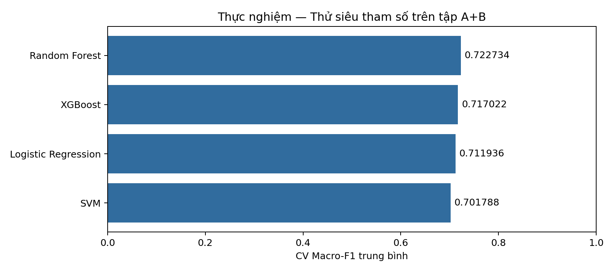

# ML01 — Dự đoán trạng thái học tập của sinh viên

Nhóm 08 - Lớp DCT124C3

Dự án dùng dữ liệu tuyển sinh và học tập để dự đoán ba trạng thái: **bỏ học (Dropout)**, **đang học (Enrolled)** và **tốt nghiệp (Graduate)**. Nhóm so sánh Logistic Regression, Random Forest, SVM và XGBoost để khảo sát liệu hai đặc trưng bổ sung từ học kỳ 1 có cải thiện kết quả phân loại hay không. 
Nguồn dữ liệu là [Predict Students’ Dropout and Academic Success — UCI Machine Learning Repository](https://doi.org/10.24432/C5MC89).


## Demo Streamlit

Chọn một hồ sơ mẫu để xem số môn đăng ký, số môn đạt và điểm học kỳ 1. Hồ sơ mẫu được đọc từ `development.csv`. Bản hiện tại hiển thị thông tin hồ sơ và thông báo trạng thái khi bấm **Dự đoán**. Nhóm sẽ kết nối mô hình sau khi chốt cấu hình bằng CV.

## Kết quả thực nghiệm

**A** gồm 36 đặc trưng gốc. **A+B** thêm tỷ lệ môn đạt học kỳ 1 và cờ đăng ký 0 môn học kỳ 1. Bảng dưới dùng các kết quả đối chiếu A và A+B trong `experiments/feature_b`, với CV phân tầng 5 fold trên tập development.

| Mô hình | CV Macro-F1 trên A | CV Macro-F1 trên A+B | Chênh lệch A+B − A |
| --- | ---: | ---: | ---: |
| Logistic Regression | 0.717353 | 0.717317 | −0.000037 |
| Random Forest | 0.716244 | **0.723427** | **+0.007183** |
| SVM (RBF) | 0.715364 | 0.717298 | +0.001934 |
| XGBoost | 0.713649 | 0.708953 | −0.004696 |

Random Forest cải thiện nhiều nhất trong lượt đối chiếu này, khoảng **0,72 điểm phần trăm Macro-F1**. SVM tăng nhẹ, Logistic Regression gần như giữ nguyên và XGBoost giảm. Hiệu quả của hai đặc trưng bổ sung vì vậy thay đổi theo mô hình. [Xem CSV tổng hợp và điểm từng fold](experiments/feature_b/).

### Thử siêu tham số trên A+B



Trong lượt thử trên biểu đồ, **Random Forest 300 cây** dẫn đầu với **0.722734**, gần với cấu hình 200 cây (**0.723427**). XGBoost đạt **0.717022**, tăng khoảng **0,81 điểm phần trăm** so với cấu hình đối chiếu trên A+B. [Xem notebook, bảng kết quả và biểu đồ của lượt thử](experiments/2026-11-14_ThuThamSo_4MoHinh_TapAB_Thuong/).

Các số trên là **điểm CV trên development**. Nhóm sẽ cập nhật bảng điểm trên tập test sau khi chốt đủ cấu hình.

## Dữ liệu và cách đánh giá

Dữ liệu có **4.424 mẫu**, chia thành **3.539 mẫu development** và **885 mẫu test** theo nhãn với seed 42. Nhóm dùng development để chọn cấu hình theo CV Macro-F1. Sau khi chốt, notebook đánh giá cuối huấn luyện lại trên toàn bộ development và tính Macro-F1 cùng Recall lớp Dropout trên test. [Nguồn dữ liệu UCI](https://doi.org/10.24432/C5MC89).

## Cài đặt và chạy demo

Mở PowerShell tại thư mục `ML01_Student_Dropout`. Dùng Python 3.12 và chạy:

```powershell
py -3.12 -m venv .venv
.\.venv\Scripts\python.exe -m pip install -r requirements.txt -r requirements_training.txt
.\.venv\Scripts\python.exe -m streamlit run .\app\app.py
```

Nếu đã dùng `.venv` ở thư mục gốc `sgu-MAYHOC`, chạy từ thư mục gốc:

```powershell
.\.venv\Scripts\python.exe -m streamlit run .\ML01_Student_Dropout\app\app.py
```

Mở **Local URL** hiện trong Terminal, chọn hồ sơ mẫu, rồi bấm **Dự đoán**. Nhấn `Ctrl+C` trong Terminal để dừng ứng dụng.

### Chạy notebook đánh giá cuối

1. Kiểm tra `data/processed/development.csv` và `data/processed/test.csv`. Nếu thiếu, chạy [notebook EDA](notebooks/01_eda.ipynb) để chuẩn bị dữ liệu.
2. Mở [notebook đánh giá cuối](notebooks/06_final_evaluation.ipynb) trong VS Code và chọn kernel của môi trường đã cài thư viện.
3. Điền 8 cấu hình đã chốt và điểm CV vào Cell 7, rồi chọn **Run All**. Notebook xuất `final_test_results.csv` ở thư mục dự án.

## Cấu trúc mã nguồn

| Thư mục | Nội dung |
| --- | --- |
| `app/` | Giao diện Streamlit |
| `data/` | Dữ liệu gốc và dữ liệu đã chia |
| `notebooks/` | EDA, thực nghiệm mô hình và đánh giá cuối |
| `feature_b/`, `src/` | Tạo đặc trưng, tiền xử lý và tiện ích đánh giá |
| `experiments/` | Notebook thực nghiệm, bảng điểm và biểu đồ |
| `models/` | Pipeline đã lưu và thông tin mô hình |
| `report/` | Hình và bảng phục vụ báo cáo |

## Tài liệu và minh chứng

- [Thư mục minh chứng trên Google Drive](https://drive.google.com/drive/folders/11ipTv80foNjFz6ELOgofEmopy6BNhIwi?usp=sharing)
